# SkillTwin database ER diagram

This diagram reflects `backend/schema.sql` and migrations through `010_cgpa_precision.sql`. It describes the current source schema; the actual deployed database still requires inspection in a disposable or authorized environment. It does not include planned resume storage, chatbot history, or a separate progress-snapshot model.

```mermaid
erDiagram
  USERS {
    int user_id PK
    string full_name
    string email UK
    string password_hash
    string target_role
    string account_role
    int readiness_score
  }

  SKILLS {
    int skill_id PK
    string skill_name UK
    string category
  }

  USER_SKILLS {
    int user_skill_id PK
    int user_id FK
    int skill_id FK
    string proficiency_level
    int proficiency_score
    decimal years_experience
  }

  CAREER_ROLES {
    int role_id PK
    string role_name UK
    string description
  }

  CAREER_ROLE_SKILLS {
    int role_id PK, FK
    int skill_id PK, FK
    string required_level
    boolean is_required
    string importance
  }

  ROADMAPS {
    int roadmap_id PK
    int user_id FK
    int role_id FK
    boolean is_current
    string status
  }

  ROADMAP_MILESTONES {
    int milestone_id PK
    int roadmap_id FK
    int skill_id FK
    int sequence_no
    int priority_score
    int estimated_hours
    string status
    datetime completed_at
  }

  USER_MILESTONES {
    int milestone_id PK
    int user_id FK
    string milestone_key
    datetime completed_at
  }

  ASSESSMENTS {
    int assessment_id PK
    string assessment_key UK
    string title
    boolean is_active
  }

  ASSESSMENT_QUESTIONS {
    int question_id PK
    int assessment_id FK
    string question_key
    json options_json
    string correct_option_key
    int points
  }

  ASSESSMENT_RESULTS {
    int result_id PK
    int user_id FK
    int assessment_id FK
    decimal score
    decimal percentage
    datetime completed_at
  }

  ASSESSMENT_RESULT_ANSWERS {
    int result_answer_id PK
    int result_id FK
    int question_id FK
    string selected_option_key
    boolean is_correct
  }

  ADMIN_AUDIT_LOG {
    bigint audit_id PK
    int actor_user_id FK
    int target_user_id FK
    string action
    json details
    datetime created_at
  }

  OAUTH_IDENTITIES {
    bigint identity_id PK
    int user_id FK
    string provider
    string provider_subject
    string email
    datetime created_at
  }

  OAUTH_LOGIN_ATTEMPTS {
    string state_hash PK
    string provider
    string nonce
    string code_verifier
    int link_user_id FK
    datetime expires_at
  }

  OAUTH_LOGIN_CODES {
    string code_hash PK
    int user_id FK
    datetime expires_at
  }

  USERS ||--o{ USER_SKILLS : records
  SKILLS ||--o{ USER_SKILLS : describes
  CAREER_ROLES ||--o{ CAREER_ROLE_SKILLS : requires
  SKILLS ||--o{ CAREER_ROLE_SKILLS : required_for
  USERS ||--o{ ROADMAPS : owns
  CAREER_ROLES ||--o{ ROADMAPS : targets
  ROADMAPS ||--o{ ROADMAP_MILESTONES : contains
  SKILLS ||--o{ ROADMAP_MILESTONES : develops
  USERS ||--o{ USER_MILESTONES : completes
  ASSESSMENTS ||--o{ ASSESSMENT_QUESTIONS : contains
  USERS ||--o{ ASSESSMENT_RESULTS : earns
  ASSESSMENTS ||--o{ ASSESSMENT_RESULTS : records
  ASSESSMENT_RESULTS ||--o{ ASSESSMENT_RESULT_ANSWERS : contains
  ASSESSMENT_QUESTIONS ||--o{ ASSESSMENT_RESULT_ANSWERS : answered
  USERS o|--o{ ADMIN_AUDIT_LOG : acts
  USERS o|--o{ ADMIN_AUDIT_LOG : targeted
  USERS ||--o{ OAUTH_IDENTITIES : connects
  USERS o|--o{ OAUTH_LOGIN_ATTEMPTS : links
  USERS ||--o{ OAUTH_LOGIN_CODES : exchanges
```

## Relationship notes

- `users.target_role` stores the selected role name. It is intentionally not a foreign key; the API validates the name against `career_roles` when it is changed.
- `career_role_skills` is the many-to-many join between roles and skills. `is_required` controls whether a mapped skill contributes to readiness and gap roadmaps; optional role skills remain available in the categorized picker.
- `skills.category` uses `common`, `core`, `soft`, or `specialized`. A skill is stored once and shared across relevant roles through `career_role_skills`.
- `roadmap_milestones` are the persisted progress items. `user_milestones` remains a separate legacy checklist table used by older client flows.
- Assessment answer keys are stored in the database and excluded from the question-fetch response. Submitted answer records reference both the saved attempt and the source question.
- Admin actor and target references become `NULL` if the related user is deleted, so the audit event itself can remain.
- OAuth identity rows belong to one user; login attempts store short-lived state/nonce/PKCE material and optional linking ownership, while login codes store one-time exchange hashes. These challenge fields are intentionally excluded from admin table browsing.
- Existing installations apply migrations 001–010 in order. Migration 010 changes `users.cgpa` to `DECIMAL(4,2)` so the documented 0–10 range includes `10.00`; `schema.sql` uses the same type for fresh installs.
- Resume analysis currently accepts text for a request and does not persist resumes or analysis history. Chat conversations and separate progress snapshots are not current tables.
